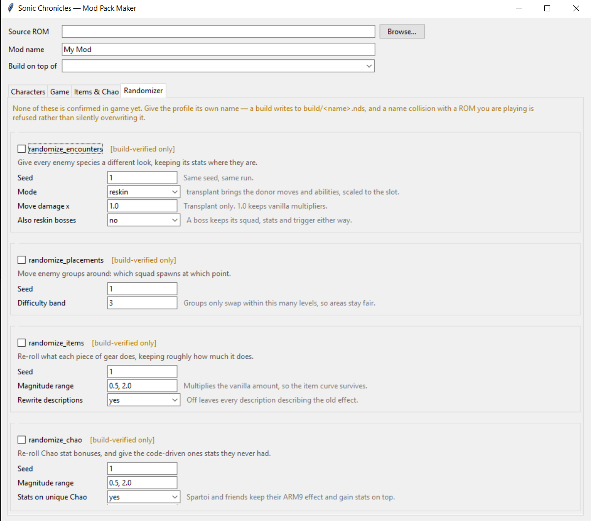
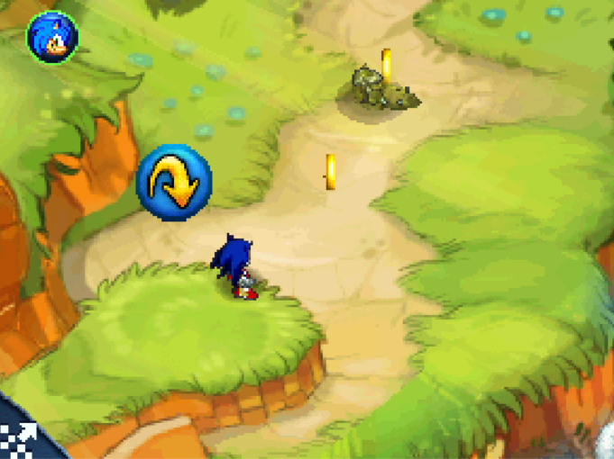
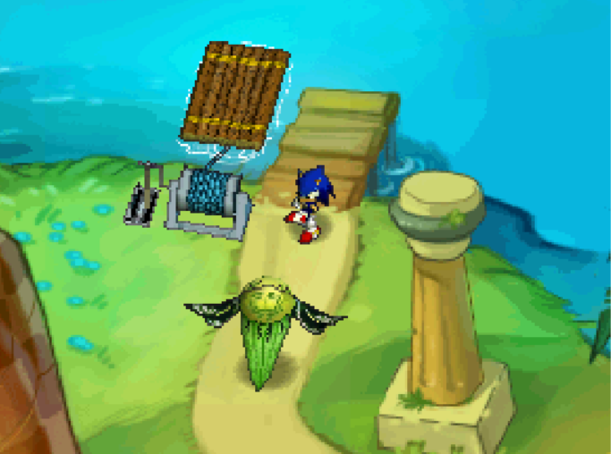
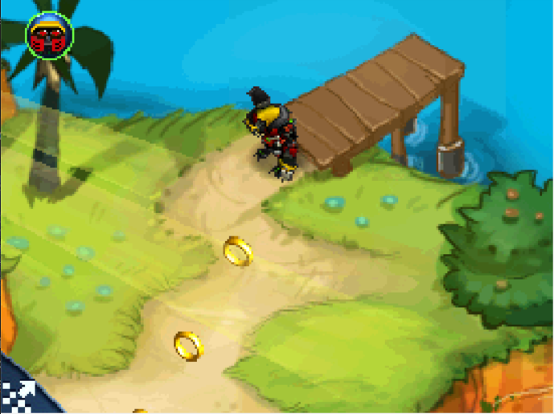
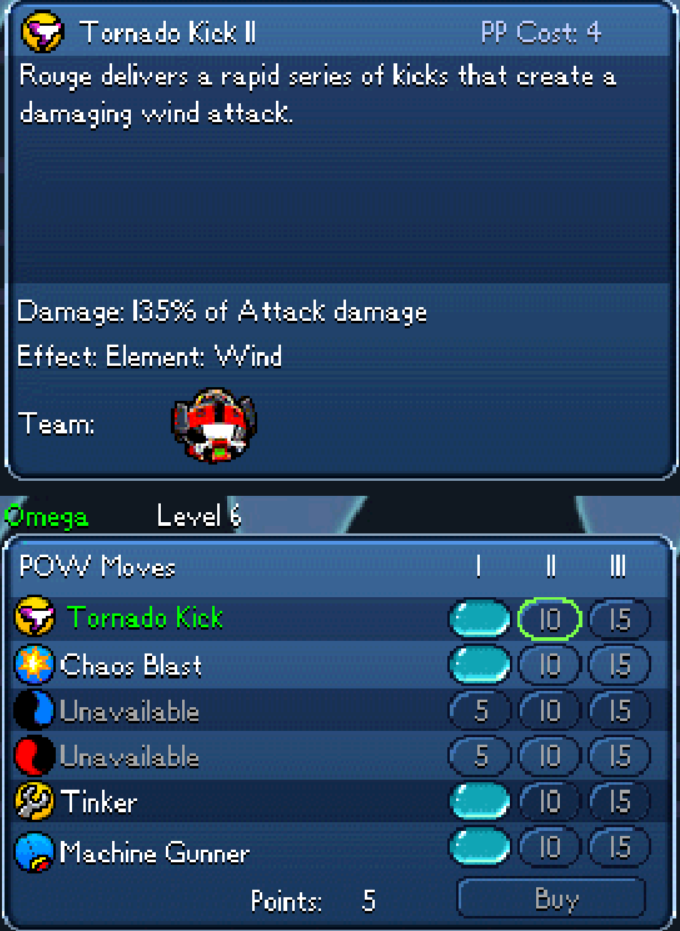
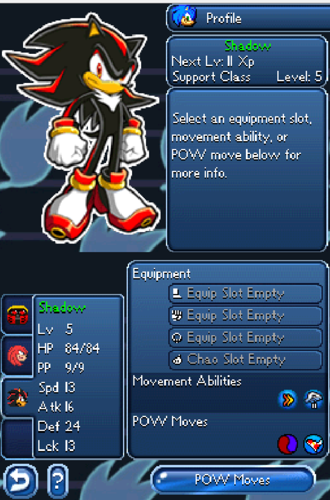
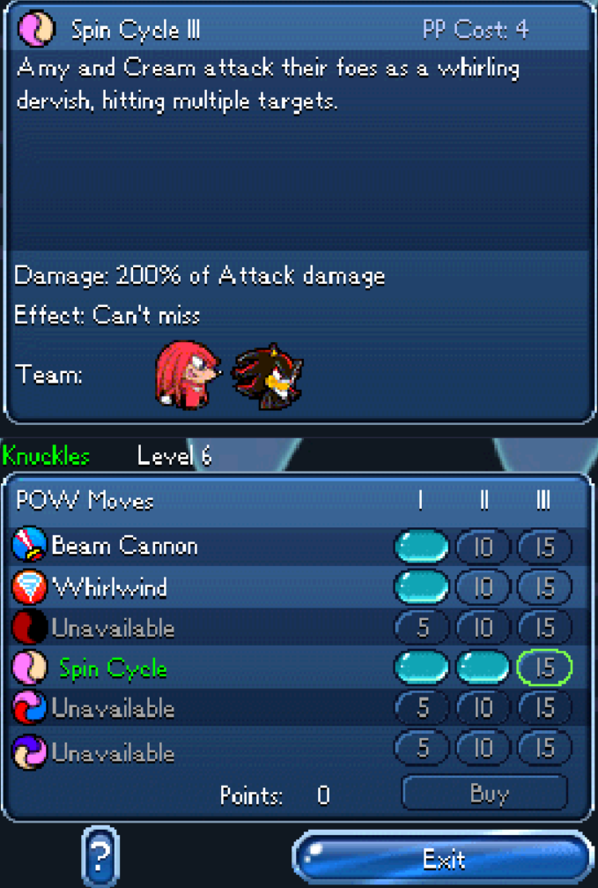
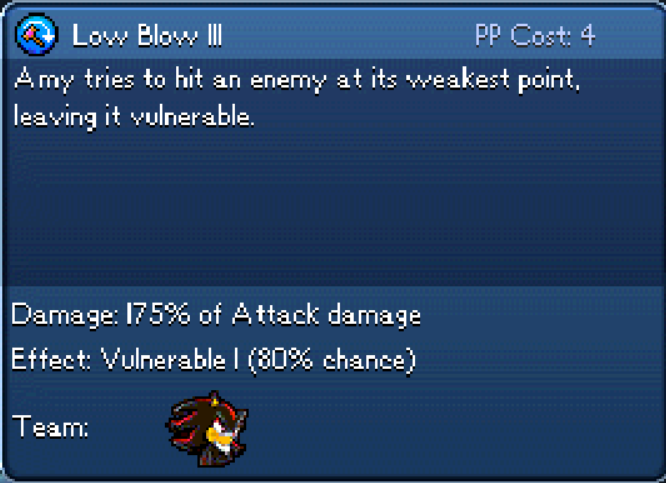
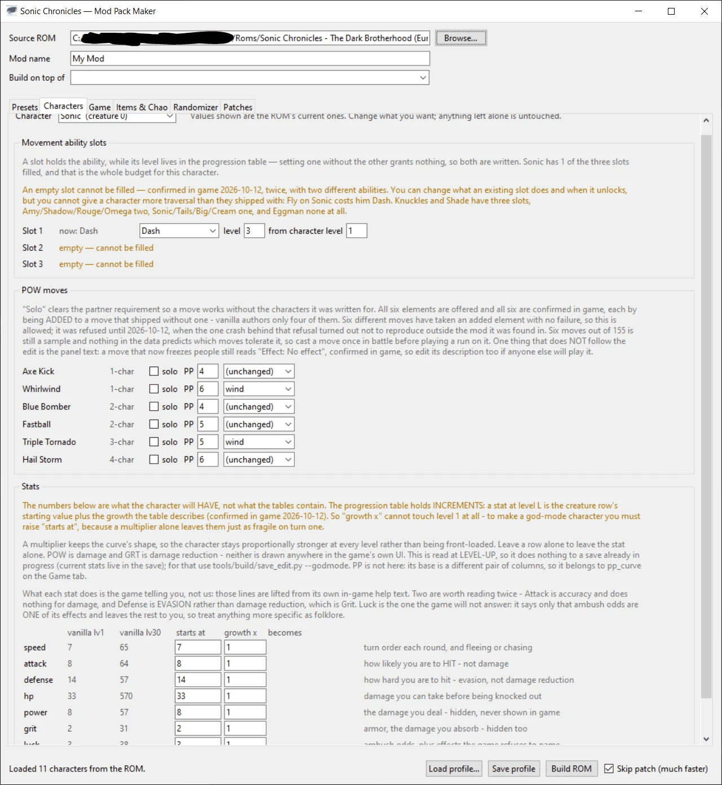

# Sonic Chronicles Mod Builder

A reverse-engineering project and modding toolkit for **Sonic Chronicles: The Dark
Brotherhood** (Nintendo DS, BioWare, 2008) — including, as far as I can establish, the
first randomizer for the game.

Everything here is written from scratch in pure Python against the ROM's own data. There
is no game data in this repository and never will be: you supply your own legally
obtained dump, and the tools read it, build a modified copy beside it, and never write to
the original.

> **Status.** The data layer is thoroughly mapped and **every randomizer feature is
> confirmed in play**, recruitment order included — it turned out to be editable after
> all, because a story point grants a creature *row* rather than a character. Two things
> remain locked inside the ARM9 executable — party-relative enemy scaling, and the
> animation and stylus pattern a POW move is performed with — and are documented as such
> rather than guessed at. Features carry an honest badge: *confirmed in game* or
> *build-verified only*.



*The Randomizer tab. Every feature carries the badge it earned — and as of 2026-10-11
**all nine randomizers are `confirmed in game`**, each verified against a prediction
made from the data before the ROM was built.*

---

## Why this game is interesting

Sonic Chronicles was developed by BioWare and runs on a descendant of the **Aurora**
engine — the lineage behind Neverwinter Nights, KOTOR and Dragon Age. So underneath a
Sonic RPG sit BioWare's data formats: GFF4 structures, TLK string tables, GDA/2DA tables,
and an ERF-family archive.

That is the good news. The bad news, and the thing that shapes this whole project: unlike
every other Aurora game, **Sonic Chronicles ships no scripts at all**. There is no
NWScript, no compiled script resources, nothing. The plot files are a registry of named
flags and journal text with no actions in them. All game *logic* is native ARM9 code.

The practical consequence is a hard line through the middle of the game. Anything
expressed as data — stats, moves, items, encounters, shops, progression — is editable and
most of it is now understood. Anything expressed as logic is not, without debugging the
binary.

---

## What it can do

Eighteen named features, each a parameter block in a JSON profile. Run
`py tools/build/modbuild.py --list-features` for the live list with badges.

### Randomizer

| feature | what it does |
|---|---|
| `randomize_characters` | Deals out who you are given and when, which POW moves they carry, and whose stat line they grow on |
| `randomize_encounters` | Reskins every enemy species, or (in `transplant` mode) appends real new creatures carrying the donor's model, moves and innate abilities at the local power level |
| `randomize_placements` | Moves enemy groups between spawn points, banded by difficulty so an area stays fair |
| `randomize_items` | Re-rolls what each piece of gear does, and rewrites its description to match |
| `randomize_chao` | Re-rolls Chao stat bonuses and gives the hardcoded-effect Chao stats they never had |
| `randomize_shops` | Redeals shop stock; prices stay with the slot so early finds stay affordable |
| `randomize_chests` | Redeals what all 53 chests hold — 120 filled slots, three to a chest |
| `randomize_drops` | Redeals the weighted drop tables, rates untouched |
| `randomize_rewards` | Redeals quest and event rewards, with optional XP/gold scaling |

<table>
<tr>
<td width="50%"></td>
<td width="50%"></td>
</tr>
<tr>
<td><em><code>randomize_placements</code> — a Queen Wasp pack displaced into Green Hill.
From a placements-only build, so nothing reskinned it: that group really was moved, and
banding held it to level 5.</em></td>
<td><em><code>randomize_encounters</code> — the tutorial fight, same scripted slot, a
different creature in it.</em></td>
</tr>
</table>

<table>
<tr>
<td width="33%"></td>
<td width="33%"></td>
<td width="33%"></td>
</tr>
<tr>
<td><em>The run opens as <strong>Omega</strong>. Recruitment grants a creature
<em>row</em>, not a character, so every story recruitment point hands out whoever now
lives in that row.</em></td>
<td><em>Omega's POW list: Rouge's Tornado Kick, Shadow's Chaos Blast, Tails' Tinker and
his own Machine Gunner. A dealt move brings its damage, cost and status effect — and its
description, which still credits whoever it was written for.</em></td>
<td><em>Shadow, recruited where Tails normally joins, keeps Tails' <strong>Fly</strong>
because that slot's abilities are a floor — plus his own Dash. No gate can become
impassable.</em></td>
</tr>
</table>

<table>
<tr>
<td width="50%"></td>
<td width="50%"></td>
</tr>
<tr>
<td><em>Spin Cycle is written for <strong>Amy and Cream</strong> — the description still
says so — but the computed <strong>Team:</strong> line reads Knuckles and Shadow, because
every owner and partner reference is remapped to wherever that character now lives. Get
this wrong and a character cannot use their own solo moves; it was wrong for a few hours
on 2026-10-11.</em></td>
<td><em>A dealt move brings its <strong>effect</strong>, not just its label. This slot
applied Weakened in vanilla; the move that landed in it applies Vulnerable, at its own
80% chance. Damage, PP cost and status all travel — only the animation and the stylus
pattern stay with the character.</em></td>
</tr>
</table>

Safety is built in rather than hoped for: quest items and key items never move, bosses and
scripted spawn points are left alone, difficulty banding keeps a level-20 enemy out of the
first zone, and a recruitment shuffle can never cost the party an ability it needed. Those rules were not guesses — each one exists because a playtest broke
something. See [REVERSE_ENGINEERING_LOG.md](REVERSE_ENGINEERING_LOG.md).

### Everything else

`level_cap`, `xp_curve`, `pp_curve`, `stat_curve`, `enemy_scaling`, `movement_slots`,
`pow_move`, `custom_item`, `custom_chao`, `chao_level`, `store_stock`.

Highlights: raise the cap past 30, give any character any movement ability in any of their
three slots, convert multi-character POW moves to solo, build custom gear and Chao, and
retune the enemy difficulty curve.



*The Characters tab, for when you want one specific change rather than a shuffle. The
values shown are read from the ROM you selected, so what you see is what is actually in
there; anything left alone is not written. A movement slot and its level live in two
different tables and setting one without the other grants nothing, so the form writes
both.*

`chao_level` is the one that gives something back rather than changing it. A Chao reaches
level 2 only by trading over wireless with one person and level 3 only by trading with a
*different* person — the game tracks **who**, not how often — so in 2026 two thirds of
the Chao system is sealed off for good. The feature grants the Max-tier effects anyway.

---

## Quick start

Requires **Python 3.8+**. No dependencies for anything in the normal path.
(`capstone` is optional and only used by the ARM9 disassembler.)

```bash
py tools/build/modbuild.py <your-rom.nds> profiles/full_randomizer.json
```

That writes `build/full_randomizer.nds` plus a `.bps` patch and a JSON report. Pass
`--no-patch` to skip patch generation, which is the slow stage.

There is also a GUI:

```bash
py tools/gui/modpack_maker.py
```

Four tabs — Characters, Game, Items & Chao, Randomizer — over the same feature registry
the CLI uses. It reads your ROM to show current values (with decoded in-game item icons)
and writes an ordinary profile. Set `SONIC_CHRONICLES_ROM` to pre-fill the ROM picker.

### Profiles

A mod is a JSON file. Features expand into primitive edits, so there is exactly one
apply-and-verify path:

```json
{
  "name": "My Mod",
  "features": {
    "level_cap": { "cap": 50 },
    "randomize_encounters": { "seed": 1, "mode": "transplant" }
  }
}
```

`extends` inherits from another profile. Explicit `edits` override features, so you can
build on a feature and then hand-correct one cell.

---

## How it is put together

```
tools/recon/    format readers      nds_rom, gff4, herf, twoda, lz77, disasm, callgraph
tools/build/    writers + pipeline  rom_build, herf_write, gff4_write, gda_write,
                                    twoda_write, tlk_write, are_write, bps,
                                    features, modbuild
tools/gui/      Tkinter front end   modpack_maker, gamedata, icons
profiles/       mods as data
research/       raw Phase 0 dumps
```

Roughly 9,700 lines of Python and 4,800 lines of documentation.

Two rules hold the shape:

- **No reverse-engineering logic in the GUI.** It discovers features from the registry
  and shells out to the same builder the CLI uses.
- **Every stage verifies itself.** A no-op rebuild must be byte-identical before any edit
  is applied; each edit is read back; the archive is revalidated; a generated patch is
  applied to the source and compared. A build that cannot prove itself aborts instead of
  writing a ROM.

### The build pipeline

Validate → expand features into edits → apply → rebuild the archive → rebuild the ROM →
verify → emit a BPS patch.

Appending data is the interesting part, because nothing in these formats can simply grow
in place. Rows, strings and list entries are written at the **end** of the file and the
pointers repointed, so nothing already present moves and every existing offset stays
valid. The old bytes become dead space.

---

## Documentation

This is a research project first. The write-ups are the point, and they distinguish
confirmed facts from hypotheses throughout.

| file | contents |
|---|---|
| [REVERSE_ENGINEERING_LOG.md](REVERSE_ENGINEERING_LOG.md) | Dated entries: what was investigated, what was found, the evidence, confidence, and what stayed uncertain. Includes the wrong turns and why they were wrong. |
| [KNOWN_FORMATS.md](KNOWN_FORMATS.md) | File formats — HERF, GFF4, GDA, TLK, NCGR/NCLR, `.gui`, `.are`, `.plo`, the NDS header |
| [KNOWN_IDS.md](KNOWN_IDS.md) | Tables and id spaces — creatures, items, Chao, moves, abilities, stats |
| [KNOWN_FUNCTIONS.md](KNOWN_FUNCTIONS.md) / [KNOWN_MEMORY.md](KNOWN_MEMORY.md) | ARM9 findings |
| [RESEARCH.md](RESEARCH.md) | External prior art, surveyed before any of our own work |
| [ROADMAP.md](ROADMAP.md) | Current status, open projects, hard limits found |

### A few things discovered here

- **POW and GRT, the game's two hidden stats, are damage dealt and damage reduction.**
  Neither is explained anywhere in the game's 18,845 strings — only Attack and Speed are.
  Confirmed by probe ROMs: POW +150 pushed hits past 200 damage while accuracy was
  unchanged; GRT +150 cut incoming damage to 1.
- **POW move damage is a percentage of a basic attack**, in half-percent units. `column x
  2` matches the game's own tier text for 110 of 110 moves.
- **HP is stored twice** in `creatures.GDA`, and writing one column without the other
  gives enemies an inflated maximum they never fill.
- **A chest's loot is three floats**, and the randomizer that writes them is confirmed in
  play. Each of the 53 chests is a placeable in its area
  Each of the 53 chests is a placeable in its area file carrying three `float32`
  parameters, which are `Items.GDA` ids with -1 for an empty slot. A whole day was spent
  proving chest contents were in ARM9 before noticing
  that the triple dismissed early as a position could not be one: the 1,035 rings in the
  game share two distinct triples between them.
- **Creature rows can be appended**, letting a randomizer build genuinely new enemies
  rather than reskins.
- **A POW moveset is bound to its row block, not to the column that names its owner.**
  That column is a *participant requirement*. A build that permuted it looked like a
  clean moveset swap in the table and in play left Sonic holding all six of his own
  moves, each now demanding Rouge before he could use one.
- **A ring and a Chao egg are the same object with one field changed.** Both are
  placeables in an area file; the type field says which. So the game's 1,035 rings are
  1,035 potential Chao.

---

## Credits

See [CREDITS.md](CREDITS.md). In short: no third-party code is used here, but the
**xoreos** project's reverse engineering of BioWare's Aurora formats is what made it
possible to know where to look.

## Licence

MIT — see [LICENSE](LICENSE). That covers the tooling and documentation here, and nothing
else.

## Legal

Not affiliated with SEGA or BioWare. Sonic Chronicles: The Dark Brotherhood is their
property. This project contains no game assets, ships no ROM, and requires you to supply
your own legally obtained copy. Distribute mods as `.bps` patches, which are useless
without the player's own ROM — never as built ROMs.
